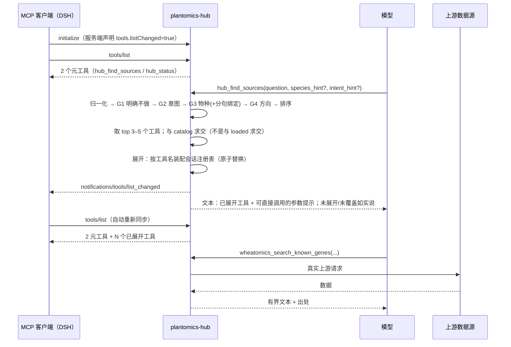

# 默认 2 元工具 + 意图驱动按需展开：目标架构、分阶段与版本路径

> **依据**：issue #37（本涛 2026-11-08 18:13 方向纠正）。本文件是**方案**，不是已实现状态；
> 代码、默认集与发布在后续阶段按本方案执行，本 PR 只落方向、差异、阶段、版本路径与文档纠正。
>
> **边界**：不改代码、不改默认集、不动 tag / npm / 市场 / 公网；不关别人的 issue / PR；
> 不改 cron / systemd / gh-app。取不到的证据写「未知 / 待实测」，不写「应该 / 通常」。

---

## 0. 五行摘要

1. **方向回到原设计**：默认只加载 `hub_find_sources` / `hub_status` 两个元工具；模型按查询意图经四道门选中 3–5 个工具，再把它们**展开进本会话**。
2. **现状不是这个架构**：`createRegistry()` 默认装配全部 10 源 / 41 工具；PR #36 / 0.2.0 把页面推荐清单升格成服务端静态默认集 7 源 / 35 工具；两处都只“给候选名 / 给静态清单”，没有按需展开。
3. **四道门可复用，缺的是展开链路**：目录与已加载集分离、工具级注册表、候选上限、MCP `tools/list_changed`、HTTP 会话隔离、`hub_status` 口径与契约测试。
4. **分阶段走**：阶段 1 stdio 先闭环并做真实 DSH 宿主验收；阶段 2 给 HTTP 加会话隔离；阶段 3 全通道切默认 2 元工具并改契约；P3 在阶段 3 前暂缓。
5. **版本路径**：0.2.0 保留并标注为“误升”（不删、不覆盖、不重发、不强推）；下一个非架构版本走 **0.2.1 补丁**，架构版本走 **0.3.0**；不做 0.1.x 字面回退。

---

## 1. 原设计 vs 现状

### 1.1 原设计（仓库原文）

| 出处 | 原文 | 含义 |
|---|---|---|
| `docs/机制说明.md:82-86` | `hub_find_sources` / `hub_status` 是两个**元工具**，注册在独立装配点，不挂任何源、不占源数 | 默认集可以只有这两个 |
| `docs/机制说明.md:97-108` | 检索层四道门：`明确不做 → 意图门 → 物种门 → 方向门 → 排序与启用集求交 → 候选 3–5 个（含工具名）` | “按工具意图选工具” |
| `docs/机制说明.md:149` | 工具数到 40 之后不再常驻新增，**改为经检索层按需展开**；判据是 `npm run stats` | 增长靠动态展开，不靠常驻 |
| `docs/架构解读.md:89`（原文） | 检索层放在模型调用之前，**帮用户选装哪几个源** | 这句把目标缩成了“选装”，本方案纠正 |

原设计的完整链路是：

```
默认 2 个元工具
  → 模型按查询意图调用 hub_find_sources
  → 四道门（明确不做 / 意图 / 物种 / 方向）+ 排序
  → 候选 3–5 个工具
  → 把候选工具展开进本会话
  → 模型直接调用展开后的工具
```

### 1.2 现状（逐项证据）

| 项 | 现状 | 证据 |
|---|---|---|
| 注册表默认值 | `createRegistry()` 不传 `enabled` 时装配全部 10 源 / 41 工具（含 2 元工具） | `src/sources/index.ts:78-125` |
| stdio 默认会话 | `createMcpServer(registry)` 的 `tools/list` 直接返回注册表全集 | `src/mcp/server.ts:57-59` |
| HTTP 默认会话 | 每个请求新建 server + transport；不带 `x-plantomics-sources` 时用服务端全集 | `src/service/http.ts:10-12,470-478,544` |
| 静态默认集 | `main` 的 `DEFAULT_SET_SOURCES` 列全部 10 源（算 41 工具）；PR #36 分支改成 7 源（算 35 工具）。两者都是“默认推荐集/页面选中态”的静态清单算法，不是按需展开 | `src/service/budget.ts:37-39,51`；PR #36 的 `docs/迁移-0.2.0.md` |
| 0.2.0 / PR #36 | 把 35 静态清单升格为服务端默认集；全库仍是 41，`scod` / `string` / `uniprot` 改请求头订阅 | PR #36 描述与 `docs/迁移-0.2.0.md`（PR #36 分支） |
| 检索层输出 | 候选按源分组渲染，未加载源标“需订阅”；正文没有“展开”动作，只有“直接调 / 加装”两条路 | `src/retrieval/find-sources.ts:949-955,1083-1091,1351-1353,1516` |
| 注册表可变性 | 创建后 `seal()`，不允许事后增删注册项 | `src/core/registry.ts:29-56` |
| MCP 能力声明 | 两个出口都只声明 `capabilities: { tools: {} }`，没有 `listChanged`，也没有发送变更通知 | `src/mcp/server.ts:53`；`src/service/http.ts:108-113` |
| 文档自述（本 PR 前） | README 写“检索层是发现入口，**不是按需展开**”；未来方向写“**不做**检索层按需展开” | `README.md:314`；`docs/未来方向-wsl-2026-11-07.md:120` |
| 候选上限 | 文档写“候选 3–5 个”，代码按字节预算尽量多给，没有 3–5 的硬上限 | `docs/机制说明.md:97-108` vs `src/retrieval/find-sources.ts:1421-1520` |

> 说明：`docs/机制说明.md` §五的图原写“与启用集求交”，与 2026-11-03 A 方案后的实际行为不符；
> 本次已把该图纠正为“全库目录检索、已加载集只做标注”，并补“3–5 上限/展开尚未实现”的现状说明。
> 上表引用的是**原设计意图**，不是修改后的文档字面。

**结论**：现状是“全库常驻（41）”或“静态裁剪（35）”二选一，**都不是**“默认 2 元工具 + 按意图动态展开”。
这是架构替换，不是 41 与 35 的数字分歧。

### 1.3 差异定性：静态裁剪 ≠ 按需展开

| 维度 | 原设计（`docs/机制说明.md`） | 现状（全库 41 / 静态 35） | 本方案（按需展开） |
|---|---|---|---|
| 默认上下文 | 2 个元工具 | 10 源 / 41 工具，或 7 源 / 35 工具，全部常驻 | 2 个元工具 |
| 工具进入会话的时机 | 查询后按意图/物种/方向门选中 | 进程启动时按固定清单 | 每次查询选中 3–5 个后展开 |
| 工具数增长 | 检索层动态决定，不常驻新增 | 改清单、发新版本 | 目录可继续加源，工具按需展开 |
| 模型看到什么 | 2 个元工具，展开后 N 个 | 35 / 41 个工具声明 | 2 个元工具，展开后 2 + N 个 |
| 谁做选择 | 模型表达意图，检索层约束 | 版本发布者预设 | 模型按问题意图选择，检索层约束 |
| 失败方式 | 检索层如实说未覆盖/未展开 | 模型看不到某能力，答“没有” | 检索层如实说未覆盖/未展开 |

因此，**不能把本方案折中成“把 35 再改回 41”或“把清单换成另一份静态清单”**。这两种都保留“启动时决定工具集”的前提。

---

## 2. 目标形态

### 2.1 四个集合，必须分开命名

| 集合 | 定义 | 目标值 | 来源 |
|---|---|---|---|
| **全库目录 catalog** | 本服务已接入的全部源与工具 | 10 源 / 41 工具（含 2 元工具） | `src/sources/index.ts` 的 `bundles`；`/catalog` 永远返回全库 |
| **服务端默认集 default** | 不带显式订阅时，会话初始注册的工具 | **2 个元工具** | 新建的 on-demand 装配 |
| **本会话已加载集 loaded** | 本次会话已展开的工具（含 2 元工具） | 2 → 2 + N | 会话状态；stdio 进程内 / HTTP 会话 |
| **显式订阅集 subscription** | 用户用 `PLANTOMICS_SOURCES` / `x-plantomics-sources` 指定的集合 | 用户指定 | 现有入口，语义不变 |

关键区分：

- **catalog 不是 loaded**：`hub_find_sources` 必须在全库目录上检索；不能因为“本会话没加载”就把候选过滤掉。
- **default 不是 page selection**：`/catalog.budget.defaultSources` 是页面初始选中态，不是 MCP 服务端默认集；两者在契约里必须分开命名。
- **loaded 不是 subscription**：展开是会话内的动态行为；显式订阅是用户给定的固定集合。显式订阅存在时，默认**关闭**按需展开，避免用户没要求的工具被加载。

### 2.2 调用链（目标）



**每一步模型看到什么**：

| 步骤 | 模型看到的工具 | 模型该做什么 |
|---|---|---|
| 会话开始 | `hub_find_sources`、`hub_status` | 先描述问题，不猜工具名 |
| 第一次 find 返回 | 仍是 2 个（下一次模型请求前会刷新） | 读候选与“已展开”列表 |
| 客户端重新同步后 | 2 + N 个（N = 本次选中的 3–5 个工具） | 直接调用已展开工具 |
| 再问新问题 | 2 + N + M（会话内累积） | 再 find；已加载的工具不重复展开 |
| 超出会话上限 | 不再新增；文本明确说上限与退路 | 用显式订阅或新会话 |

### 2.3 展开单位、上限与幂等

- **展开单位是工具，不是源**。`hub_find_sources` 的候选本来就是工具级（`selectCandidates` 返回 `picked: Scored[]`，按工具计）；如果按源展开，问一个小麦基因就要常驻 WheatOmics 的 11 个工具，等于把静态裁剪换个形式重来。
- **每次 find 最多展开 3–5 个工具**（与 `docs/机制说明.md:97-108` 的“候选 3–5 个”对齐）。少于 3 个就按实际数量；不凑数。
- **会话累计上限**：沿用 `SUBSET_TOOLS_HARD_MAX = 80` 作为硬上限；`DEFAULT_SET_TOOLS_SOFT_MAX = 40` 作为软建议，超过只提示不拒绝。达到 80 后拒绝继续展开，文本给出“新会话 / 显式订阅 / 缩小问题”三条退路。
- **不驱逐**：v1 不做 LRU 驱逐。删掉模型刚看过的工具，会让它下一轮调用 404；会话结束自然释放。
- **幂等**：重复 find 命中已加载工具时不重复注册、不发多余通知；只对新工具发一次 `tools/list_changed`。
- **原子性**：先构造新注册表，成功后再替换；失败保留旧注册表，返回错误文本，不出现“一半工具注册、一半没注册”。

### 2.4 一个具体例子（示例，实际候选以代码为准）

问题：「小麦里调控春化的已知基因」。

| 步骤 | 工具列表 | 说明 |
|---|---|---|
| 会话开始 | `hub_find_sources`、`hub_status` | 2 个 |
| 调用 `hub_find_sources(question="小麦里调控春化的已知基因")` | 仍为 2 个；返回文本列出候选 `wheatomics_search_known_genes` / `wheatomics_gene_detail`，并写明“已展开” | 四道门命中小麦 + 已知基因意图 |
| 客户端重新同步 | 2 + 2 | 只展开候选工具，不展开 WheatOmics 全部 11 个 |
| 模型调用 `wheatomics_search_known_genes(...)` | — | 参数 schema 由 `tools/list` 提供 |
| 再问「这些基因的表达」 | 2 + 2 + 1（表达工具） | 已加载的不重复；新命中的只加增量 |

### 2.5 stdio 与 HTTP 的差异

| 入口 | 会话模型 | 展开可行性 | 方案 |
|---|---|---|---|
| stdio（`plant-omics-mcp`） | 一个进程一个客户端，天然单会话 | 高 | 进程内可变 `loadedTools` + `sendToolListChanged()` |
| HTTP `/mcp`（公网 / 自建） | 当前**无状态**：每请求新建 server + transport | 低 | 启用 MCP `Mcp-Session-Id` 会话；按会话保存已展开工具名，TTL + 上限；同一会话复用 transport/server 才能发通知 |
| HTTP 显式订阅 | 每请求 `x-plantomics-sources` | 不需要展开 | 语义不变；显式集合优先，默认关闭按需展开 |
| DSH 插件 | 薄壳，工具来自 MCP 客户端 | 取决于宿主 | 宿主需支持 `notifications/tools/list_changed`；本地已安装的 DSH MCP 客户端支持（见 §7 未知项） |

> **HTTP 无状态是现有契约（`docs/catalog契约.md` §七）**。改成会话态不是“顺手加个 Map”：
> 需要 TTL、并发上限、会话隔离、DELETE 清理、单进程/粘性路由约束，并修订契约里“不做订阅持久化”的表述。
> 会话里只保存**本会话已展开的工具名**，不保存用户身份、查询内容或订阅；这不是账号/订阅持久化。

---

## 3. 四道门评估：从“给候选名”到“真展开”

### 3.1 四道门现在做什么

| 门 | 现有实现 | 对展开是否可复用 |
|---|---|---|
| **G1 明确不做** | `detectComputation()` 在意图识别前拦下设计/计算类任务；命中时 `candidates=[]`、`intents=[]` | ✅ 直接复用；命中时不展开 |
| **G2 意图门** | `detectIntents()` + `tool.intents` 求交 | ✅ 直接复用；决定“选哪类工具” |
| **G3 物种门** | `speciesScope.query` / `target` + `speciesSatisfies()`；含分句绑定、点名源、示例非承诺等分支 | ✅ 直接复用；决定“这个工具覆不覆盖” |
| **G4 方向门** | `resolveDirection()` + `speciesScope.target`；按方向标记判，不按集合交集 | ✅ 直接复用 |
| **排序** | 命中维度 > 语义等级 > 注册顺序 | ⚠️ 需要增加“取 top N”截断与稳定键 |
| **与启用集求交** | 2026-11-03 A 方案改为“未加载也进候选，标需订阅”；不再过滤 | ❌ 展开模式要改成“catalog 检索 + loaded 标注”，不是“未加载就不可执行” |

四道门的判定逻辑本身不需要重写；**需要补的是门后的执行链路**。

### 3.2 七个缺口（按依赖顺序）

| # | 缺口 | 现状 | 要补什么 | 验收判据 |
|---|---|---|---|---|
| 1 | **目录 / 已加载分离** | `findSources` 用 `enabledTools`（= 注册表工具）判断 `installed`；meta-only 时全部为 false，候选会被标成“需订阅” | 检索始终在**全库目录**上做；`loadedTools` 只用于标注“已展开/未展开”；显式订阅模式保留旧语义 | 默认 2 元工具时，问“小麦春化基因”仍能给出 wheatomics 候选，并标“可展开”，不是“需订阅” |
| 2 | **注册表只支持整源、且 seal 不可变** | `createRegistry({ enabled })` 按源启用；`seal()` 后不能增删；空数组等于全库 | 新增 **meta-only 装配** 与 **工具级子集装配**（按工具名注册，源 manifest 保留）；会话层每次展开构造新注册表，不改旧实例 | 能装配“2 元工具 + 3 个指定工具”；未知工具名报错；旧注册表不被修改 |
| 3 | **find 没有展开动作** | `hub_find_sources` 只返回文本与 `raw`；文本的“下一步”是“直接调（已加载）”或“加装（未加载）” | 增加展开选择与回调：`findSources` 返回 top N 工具；工具包装层调用 `onExpand(tools)`；文本区分“已展开 / 可展开 / 未覆盖” | 调用一次 find 后，注册表工具数从 2 变为 2+N；重复调用不重复 |
| 4 | **候选没有 3–5 上限** | 代码按字节预算尽量多给；文档写 3–5 | 在 `selectCandidates` 排序后取 top 3–5；不足不凑；多出的候选只在文本里提示“还有 N 个未展开” | 构造 10 个命中源时，只展开 ≤5 个工具；文本说明还有未展开项 |
| 5 | **MCP 没有 listChanged** | `capabilities: { tools: {} }`；没有发送通知 | 声明 `{ tools: { listChanged: true } }`；展开后 `server.sendToolListChanged()`；宿主重新 `tools/list` | 客户端在 find 后收到通知并重新列工具；模型下一轮能看到新工具 |
| 6 | **HTTP 无状态，无法保存展开** | 每请求新建 server + transport；`sessionIdGenerator: undefined` | 启用 `Mcp-Session-Id`；会话表（TTL/上限/清理）；同一会话复用 transport/server；DELETE 关闭；单进程或粘性路由 | 两个并发会话各自展开，互不污染；断开会话后工具不泄漏；无会话时行为可预期 |
| 7 | **`hub_status` / 契约 / 闸门口径** | `hub_status` 从注册表读源与工具；meta-only 时会报 0 源；`/catalog` 的 `defaultSetTools` 语义是“不带订阅头下发数”；`check:contracts` 锁三处相等 | `hub_status` 分列 catalog / default / loaded / expanded / budget；`/catalog` 增加 `serverDefault` 与 `expandable` 语义；`check:contracts` / `check:counts` / `status-report` 改成新口径（闸不删，负例仍 exit 1） | `/catalog`、`/healthz`、`stats`、`hub_status` 对“目录 10/41、默认 2、已展开 N”四件事各自说清，不再用同一个数混指 |

### 3.3 目标接口草案（实现时可按等价方式落地）

```ts
// 1) 装配：默认只有元工具；可选工具级子集
createRegistry({ mode: 'on-demand' })                    // 2 个元工具
createRegistry({ tools: ['wheatomics_search_known_genes'] }) // 2 + 1

// 2) 会话：已展开工具集合（stdio 进程内 / HTTP 会话）
interface SessionToolSet {
  readonly loaded: ReadonlySet<string>;
  expand(tools: readonly string[]): { registry: ToolRegistry; added: string[] };
}

// 3) 元工具：find 返回选择，包装层执行展开
hub_find_sources(question, species_hint?, intent_hint?)
  // raw.expansion = { selectedTools, expanded, alreadyLoaded, remaining, reason }
  // 文本：已展开 / 可展开 / 未覆盖 三段，分别给工具名

// 4) 服务端：注册表替换 + 通知
server.setRegistry(nextRegistry);
server.sendToolListChanged();
```

**关于 `readOnlyHint`**：`hub_find_sources` 仍声明只读（不改上游数据），但它会改变本会话的工具集。工具描述必须写明“会展开工具”，避免宿主把“只读”理解为“无任何副作用”。

### 3.4 与现有“未加载源”方案的关系

2026-11-03 的 A 方案（`src/retrieval/find-sources.ts:1083-1091`）把“库里有、本会话没装”显式标成“需订阅”，这是对的，但它假设“加载”只能由服务端配置/请求头完成。展开模式把这条路径补成：

```
未加载 → 可展开（默认模式）→ find 选中 → 展开 → 已加载
未加载 → 需订阅（显式订阅模式）→ 用户加请求头/环境变量
```

两种模式都要保留：显式订阅是用户控制，展开是默认体验。文本必须区分，不能把“可展开”写成“需订阅”，也不能把“需订阅”写成“可展开”。

---

## 4. 分阶段方案

### 4.1 阶段总表

| 阶段 | 目标 | 主要代码 | 完成判据 | 明确不做 |
|---|---|---|---|---|
| **0（本 PR）** | 方向、差异、阶段、版本路径落纸 + 两处降格表述纠正 | 仅文档 | 本文件 + README / 未来方向 / 契约 / CHANGELOG / 架构解读 / 机制说明 的纠正；`npm run check` exit 0；无代码/默认集/tag 变化 | 不实现展开、不发版 |
| **1** | stdio 默认 2 元工具 + 工具级展开闭环 | `src/core/registry.ts`、`src/sources/index.ts`、`src/retrieval/*`、`src/mcp/*`、测试 | 本地 stdio：初始 `tools/list`=2；find 后展开 3–5 个；模型能调用并取数；真实 DSH 宿主验收通过 | 不动 HTTP/公网；不发版 |
| **2** | HTTP 会话隔离 + 展开 | `src/service/http.ts`、`src/service/catalog.ts`、`docs/catalog契约.md`、测试 | 两个并发会话互不污染；find 后 `tools/list` 增加且通知可达；显式订阅语义不变；TTL/上限/清理有效 | 不切换公网默认集，直到阶段 3 |
| **3** | 全通道默认 2 元工具 + 契约/文档收尾 + 发布 | 上述 + `scripts/*` 闸门 + README / CHANGELOG / 迁移文档 | 四通道一致；`check:contracts` / `check:counts` 新口径负例 exit 1；`npm run check` exit 0；发布与部署验收 | 不删数据、不强推、不覆盖 tag |

### 4.2 阶段 0：本 PR（方案与文档纠正）

- 新增本文件；纠正 `README.md:314`、`docs/未来方向-wsl-2026-11-07.md:120`。
- 同步纠正 `docs/catalog契约.md`（默认集语义）、`docs/架构解读.md:89`、`docs/机制说明.md:149` 附近的现状说明、`CHANGELOG.md` 的 0.2.0 状态。
- **不改** `src/`、`test/`、`package.json`、`package-lock.json`、tag、npm、市场、公网。
- 验收：`npm run check` exit 0；`git diff --check` exit 0；`git diff --stat` 只含文档。

### 4.3 阶段 1：stdio 按需展开（最小闭环）

**实现顺序**：

1. **装配**：`createRegistry()` 增加 `mode: 'on-demand'`（或等价参数），只注册 2 个元工具；`enabled: []` 的旧语义（空=全库）不能复用，必须显式区分。
2. **工具级子集**：增加按工具名装配的能力；保留源 manifest（tier/species/displayName），但 `tools` 只含选中项；未知工具名报错；`seal()` 仍在装配末尾。
3. **会话层**：stdio 进程内维护 `loadedTools: Set<string>`；`expand(tools)` 构造新注册表；失败不替换。
4. **find 改造**：在 catalog 上检索；`selectedTools` 取 top 3–5；`onExpand` 回调；文本分“已展开 / 可展开 / 未覆盖”；`raw.expansion` 给结构化结果。
5. **server**：`capabilities.tools.listChanged = true`；展开后 `sendToolListChanged()`；`tools/list` 从当前注册表读。
6. **hub_status**：分列 catalog / default / loaded / expanded / budget；不再把“本会话 0 源”写成“服务没有源”。
7. **instructions**：MCP `initialize.instructions` 改成“默认只有 2 个元工具；先 find，再调展开的工具”。
8. **兼容开关**：`PLANTOMICS_SOURCES` 显式订阅时关闭按需展开；提供 `PLANTOMICS_ON_DEMAND=0` 回退到静态默认集（回滚用，不写进主路径）。
9. **测试**：默认 2；find 后 2+N；幂等；上限；未知工具；G1 拒答不展开；显式订阅不变；`npm run check` 全绿；负例 exit 1。

**验收（必须真实执行）**：

- 本地 stdio MCP 客户端：`tools/list` 初始 2；`hub_find_sources("小麦 春化 已知基因")` 后出现 wheatomics 工具；调用返回数据。
- 真实 DSH 宿主会话（本地 stdio 配置）：模型先 find，下一轮看到并调用展开工具，输出带出处。**这是阶段 1 的硬门槛**；如果宿主不刷新，先停下来评估，不进入阶段 2。
- 负例：把展开上限改成 0，文本应说明“未展开”，不得静默；把工具名写错，exit 1；G1 任务不产生任何展开。
- 计数闸：`npm run check:counts` / `check:contracts` 按新口径更新，旧断言不删，负例仍 exit 1。

**回滚**：`PLANTOMICS_ON_DEMAND=0` 或 `PLANTOMICS_SOURCES=<原清单>` 回到静态 41；无数据迁移；不发版。

### 4.4 阶段 2：HTTP 会话隔离 + 展开

**实现顺序**：

1. **会话表**：`Map<sessionId, { transport, server, loadedTools, lastSeen }>`；初始化时创建；TTL（建议 30 min）与最大会话数（建议 1000）；定时清理；`DELETE /mcp` 关闭。
2. **传输**：`StreamableHTTPServerTransport({ sessionIdGenerator: () => randomUUID(), enableJsonResponse: true })`；同一会话复用；无会话/过期按 MCP 规范返回 404，让客户端重新 initialize。
3. **展开**：`hub_find_sources` 的 `onExpand` 对会话注册表操作；`sendToolListChanged()` 走该会话的 transport；通知失败不影响工具结果，但文本要提示“宿主未刷新”。
4. **显式订阅**：`x-plantomics-sources` 仍按请求解析；显式订阅时关闭展开；会话内不合并不同请求的订阅集，避免“上一个用户的选择泄漏”。
5. **契约**：`/catalog` 增加 `budget.serverDefaultTools`（2）、`budget.expandableTools`（41）、`budget.defaultSources` 明确定义为“页面初始选中态”；旧字段保留兼容，语义写清。
6. **文档**：`docs/catalog契约.md` §七“不做订阅持久化”改为“不做账号/订阅持久化；会话只保存已展开工具名，TTL 自动清理”。
7. **测试**：并发两会话隔离；TTL 过期；会话上限；通知可达；显式订阅不变；无状态回退（`PLANTOMICS_MCP_SESSIONS=0`）行为明确。

**验收**：本地 HTTP 两个客户端各自展开、互不污染；DSH 远端连接下 find 后工具刷新；公网部署前做一次回环 + 单会话/双会话实测；未通过不切公网默认集。

**回滚**：`PLANTOMICS_MCP_SESSIONS=0` 回到无状态 + 静态默认集；不删会话数据（本来不落盘）。

### 4.5 阶段 3：全通道切换 + 契约/文档收尾

- 全通道默认 2 元工具；删除“服务端静态默认集 = 7/35 或 10/41”的口径。
- `DEFAULT_SET_SOURCES` 保留为**页面初始选中态**的唯一来源，不再参与服务端默认集；如果页面不再需要，另开契约变更。
- `/catalog`、`/healthz`、`stats`、`hub_status` 的口径统一为：catalog / default（2 元工具）/ loaded / expandable。
- `check:contracts`、`check:counts`、`status-report` 更新（不删闸，负例仍 exit 1）。
- README / CHANGELOG / 迁移说明 / `docs/catalog契约.md` 全部改到新口径；`docs/迁移-0.2.0.md` 若随 PR #36 存在，删除或改写为“0.2.0 误升说明”。
- 发布 **0.3.0**（见 §5），四通道对齐；公网部署按现有门禁执行。
- P3 恢复：P3 的抽检/降级策略**不得**写死“默认 35”或“默认 41”，必须用 `catalog / default / expanded` 三个参数化读数。

### 4.6 兼容矩阵

| 场景 | 阶段 1 后 | 阶段 3 后 |
|---|---|---|
| `npx ... plant-omics-mcp`（未设环境变量） | 2 元工具，按需展开 | 同左 |
| `PLANTOMICS_SOURCES=...` | 显式订阅，原样下发，不展开 | 同左 |
| HTTP 不带 `x-plantomics-sources` | 暂维持现状（源码 41；已发布 0.2.0 仍 35），文档标注“未切换” | 2 元工具，按会话展开 |
| HTTP 带 `x-plantomics-sources` | 原样，不展开 | 原样，不展开 |
| DSH 市场装 0.2.0 | 仍静态 35；文档标注误升 | 升级到 0.3.0 后按需 |
| 不支持 `list_changed` 的 MCP 客户端 | 只看到 2 元工具，无法调用展开工具；文档给显式订阅退路 | 同左；或走后续网关方案（需另行确认） |
| 库用户 `createRegistry()` | 保持全库 41（公共 API 不变） | 同左 |
| `/catalog` | 全库 10/41；新增/明确 default 语义 | 同左 |

> **老用户固定集合的退路**：0.2.0 用户若想继续固定 35（7 源）或恢复到 41（10 源），把对应源清单作为
> `PLANTOMICS_SOURCES` / `x-plantomics-sources` 显式订阅即可；显式订阅模式关闭按需展开，行为可复现。
> 这是“保留用户控制”，不是把默认集改回静态清单。

### 4.7 P3 暂缓（本涛 §四.4）

- 在阶段 3 完成前，P3 的“工具级抽检/降级策略”不启动；不把“默认 35”作为任何 P3 文档、测试、阈值的前提。
- 现有 `docs/未来方向-wsl-2026-11-07.md` 的 P3 行保留为历史；在本文件与未来方向文档加“P3 等待架构切换”的说明。
- P3 恢复条件：阶段 3 验收通过，`/catalog`、`/healthz`、`stats`、`hub_status` 的新口径稳定 ≥ 7 天，且没有因展开导致的工具数漂移。

---

## 5. 版本号方案

### 5.1 既成事实（2026-11-08 核对）

| 通道 | 读数 | 证据 |
|---|---|---|
| 源码 `main` | `0.1.2`（10 源 / 41 工具） | `package.json`；`git log -1` |
| PR #36 分支 | `0.2.0`（7 源 / 35 工具） | PR #36 描述；`docs/迁移-0.2.0.md` |
| npm | `latest = 0.2.0`；`0.1.0` / `0.1.1` / `0.1.2` / `0.2.0` 已发布 | `npm view plantomics-hub dist-tags versions time` |
| git tag | `v0.2.0` 已存在（tag 指向 `bac4fd9`，PR #36 分支 head 为 `3e71a94`；另有 `v0.1.0` / `v0.1.1` / `v0.1.2` / `v0.5.0`） | `gh api repos/.../git/ref/tags/v0.2.0`；PR #36 `headRefOid` |
| 市场 | `versions[0] = 0.2.0` | PR #36 描述；`market/index.json`（PR #36 分支） |
| 公网 | `/healthz = 0.2.0+svc.8.g3e71a94`；`/catalog.budget.defaultSetTools = 35` | 本次 `curl https://datamcp.moilab.net/healthz` 与 `/catalog` 实测 |

**约束**：npm 版本不可重用；不删/覆盖已有 tag；不强推；不改已发布 tarball；不重发已发布的 0.1.x。
0.2.0 是既成事实，**不能当作没发生**。

### 5.2 决策

| 版本 | 处置 | 内容 |
|---|---|---|
| **0.2.0** | **保留 + 标注误升** | 已发布/已部署的 tarball 原样保留；不删 tag、不重发、不强推。在 CHANGELOG / README / 市场文案中标注“无架构变更的误升；按 #37 该静态 35 口径作废”。等功能替代版本发布后，可用 `npm deprecate plantomics-hub@0.2.0 "误升版本，无架构变更；请使用当前版本"` 提醒（不删除、不改 tarball）。 |
| **0.2.1** | **下一个补丁** | 重做 PR #36 的非架构修复（doctor / 市场对齐 / provenance / 文档），**移除 35 静态默认集**，默认仍是 41；包版本 0.2.1。这是“补丁”，不是架构变更。 |
| **0.3.0** | **架构版本** | 阶段 3 完成后发布：默认 2 元工具 + 按需展开全通道。架构变更按规则升 minor；0.2 已被占用，所以下一个可用 minor 是 0.3.0。 |
| **0.1.x 字面回退** | **不做** | 发 0.1.3 会把 npm `latest` 从 0.2.0 倒退，`^0.2.0` 用户拿不到修复；这属于硬回退，违反 §五边界。若本涛明确要求恢复 0.1.x 字面线，需要单独授权并接受 latest 降级。 |

**为什么后续不按“破坏性变更 → 升 minor”的通用惯例再跳位？**

- 通用语义化版本把“工具消失”当破坏性变更；PR #36 的 0.2.0 就是按这个惯例写的。
- 本涛的产品口径是：**版本号只跟架构走，不跟静态清单大小走**。41→35 没有架构改变，所以不该升 minor。
- 0.2.0 已经发出，编号不可回收；把它标注为误升，**从 0.2.1 起按产品口径排**：
  - 非架构修复 → 补丁位（0.2.1、0.2.2…）；
  - 架构改变 → minor 位（0.3.0）。
- 两种口径不冲突：语义化版本描述“兼容性”，产品口径描述“这个仓库怎么排版本”；本方案以本涛口径为准，并在 CHANGELOG 写明这次例外。

### 5.3 发布顺序（后续执行，本 PR 不做）

1. 重做 PR #36：去掉静态 35 默认集，保留非架构修复，版本 0.2.1；`npm run check` / `check:counts` / `check:contracts` 全绿。
2. 发布 0.2.1：tag `v0.2.1` → `publish-npm.yml` → 市场 `versions[0]` → 公网部署；四通道核对。
3. 完成阶段 1–3；发布 0.3.0；更新 CHANGELOG / README / 契约 / 迁移说明。
4. 0.2.0 的 deprecate 只在 0.2.1 或 0.3.0 可用后执行，避免用户无版本可升。

### 5.4 CHANGELOG 要写清的三件事

1. 0.2.0 是**误升**：没有架构变更；静态 35 口径作废。
2. 0.2.1 是**补丁**：保留修复、移除静态默认集；为什么不是 0.2.0 的“继续”。
3. 0.3.0 是**架构版本**：默认 2 元工具 + 按需展开；为什么这次可以升 minor。

---

## 6. 文档改动清单

### 6.1 本 PR 已改（阶段 0）

| 文件 | 改动 | 理由 |
|---|---|---|
| `README.md:314` | 把“检索层是发现入口，不是按需展开”改为“发现 + 按需展开的目标架构；当前发布版尚未完成展开”，并保留默认清单句（`check:counts` 认这句） | 纠正对原设计的降格表述，同时不谎称已实现 |
| `docs/未来方向-wsl-2026-11-07.md:120` | 把“不做检索层按需展开”改为“按需展开是目标架构，独立于四段；P3 等待架构切换” | 本涛点名要改的两处之一 |
| `docs/未来方向-wsl-2026-11-07.md` 顶部 | 加 2026-11-08 方向纠正说明：P1 的 35/41 静态选择与 P3 的默认 35 前提作废 | 防止后续派活继续按旧口径 |
| `docs/catalog契约.md` | 加 v1.5 说明：`defaultSources` 是页面初始选中态，不是 MCP 服务端默认集；服务端默认集目标为 2 元工具；字段调整待阶段 2/3 | 修正“页面清单 = 分发架构”的误用 |
| `docs/架构解读.md:89` | 把“帮用户选装哪几个源”改为“按意图在会话内展开工具；当前仍是候选名” | 同类的降格表述，一并纠正 |
| `docs/机制说明.md:149` 附近 | 保留原设计，补一句“当前实现只到候选名；3–5 上限与展开待阶段 1” | 避免把目标写成现状 |
| `CHANGELOG.md` 0.2.0 段 | 标注“已发布但 PR #36 未合并；无架构变更，属误升；静态 35 口径作废” | 版本事实与方向纠正 |
| `docs/架构-按需展开-2026-11-08.md` | 新增本文件 | 方案交付物 |

### 6.2 后续必须改（阶段 1–3）

| 文件 | 改什么 | 阶段 |
|---|---|---|
| `README.md` 默认清单句 / `/healthz` 示例 / `check:contracts` 说明 | 默认 2 元工具；默认清单句改为“页面初始选中态”或删除；计数闸改口径 | 3 |
| `CHANGELOG.md` | 0.2.1 / 0.3.0 条目；架构变更与版本规则说明 | 2.1 / 3 |
| `docs/catalog契约.md` | v2：`serverDefaultTools` / `expandableTools`；`defaultSources` 语义；§七会话态修订 | 2 / 3 |
| `docs/迁移-0.2.0.md`（若 PR #36 带来） | 删除或改写为“0.2.0 误升说明”；不再教用户订阅回 35 | 2.1 |
| `docs/机制说明.md` | 把四道门后的“候选 3–5”写成已实现；补展开链路 | 3 |
| `docs/未来方向-wsl-2026-11-07.md` | P3 行恢复时改为参数化默认集，不写死 35/41 | 3 |
| `docs/架构解读.md` | 更新检索层定位与调用链 | 3 |
| `scripts/counts.mjs` / `check-contracts.mjs` / `status-report.mjs` | 新默认集与三处读数；不删闸，负例 exit 1 | 3 |

---

## 7. 验收、风险与未知

### 7.1 本 PR 验收

| 项 | 命令 / 判据 | 预期 |
|---|---|---|
| 只改文档 | `git diff --stat` | 只含 `*.md` |
| 空白/冲突标记 | `git diff --check` | exit 0 |
| 离线全检 | `npm run check` | exit 0（typecheck / test / build / counts / site / wording / stats / contracts） |
| 计数闸未被绕过 | `npm run check:counts` | exit 0；README 默认清单句仍与 `DEFAULT_SET_SOURCES` 一致 |
| 负例仍生效 | 临时改 README 数字 → `npm run check:counts` | exit 1（改回） |

### 7.2 风险与回滚

| 风险 | 影响 | 缓解 |
|---|---|---|
| 宿主持久化不刷新 `tools/list` | 模型看得到候选名却调不到工具 | 阶段 1 真实 DSH 宿主验收为硬门槛；不通过就不进阶段 2；文档给显式订阅退路 |
| HTTP 会话态引入内存/隔离问题 | 会话泄漏、内存增长、多进程不一致 | TTL + 上限 + DELETE 清理；单进程/粘性路由约束；会话只存工具名；开关回退 |
| 展开过多工具挤爆上下文 | 模型上下文变贵、变慢 | 每次 3–5；会话 80 硬上限 / 40 软建议；`hub_status` 报读数 |
| 文档先于实现造成“已实现”误读 | 用户以为默认 2 已上线 | 所有文档写“目标 / 未实现”；README 保留当前默认值；本 PR 不改代码 |
| PR #36 与 0.2.0 的既成事实冲突 | 版本线混乱 | 0.2.0 保留标注；0.2.1 重做修复；0.3.0 架构；不硬回退 |
| P3 继续按 35 派活 | 返工 | 未来方向文档加暂停说明；P3 恢复条件写死 |

**本 PR 回滚**：纯文档，`git revert` 即可；无运行时、数据、tag、发布影响。

### 7.3 未知 / 待实测

- **真实 DSH 宿主**：本地安装的 `@deepseek-ai/dsh-mcp-client` 源码支持 `notifications/tools/list_changed` 并自动重同步（README 与 `lib/index.js` 的 `listChanged` 配置）；但项目 README 的目标版本是 DSH 44.7.0，**真实宿主会话未验收**。阶段 1 必须实测。
- **HTTP 客户端会话行为**：DSH 的 `StreamableHTTPClientTransport` 支持 `Mcp-Session-Id`，但公网/代理/多进程下的表现未实测；阶段 2 用回环 + 双会话验证。
- **不支持 `list_changed` 的客户端**：只看到 2 元工具，无法调用展开工具；是否需要网关兜底（在 `hub_find_sources` 上增加调用转发）需另行确认，本方案不默认做。
- **展开后的 token 成本**：每次 3–5 个工具的实际 token 增量未实测；阶段 1 用 `hub_status` 的估算与真实会话记录核对。
- **0.2.0 已部署服务的处置**：0.2.1 发布后是否立即部署（版本号升到 0.2.1、默认集回到 41），需按部署门禁与授权单独确认；本方案只给顺序，不代为执行。

---

## 8. 不做

- 不把本方案折中成“静态 35 / 静态 41 / 另一份静态清单”。
- 不在阶段 3 前把 P3 的抽检/降级策略建立在“默认 35”上。
- 不删/覆盖已有 tag，不重发 0.1.x，不强推，不改已发布 tarball。
- 不合并、不 auto-merge、不关闭 PR #36；PR #36 的处置由桌面侧按本方案决定。
- 不改 cron / systemd / gh-app；不删既有闸；负例仍 exit 1。

---

*本文件是方向方案；实现、发布与部署在后续阶段单独验收。*
